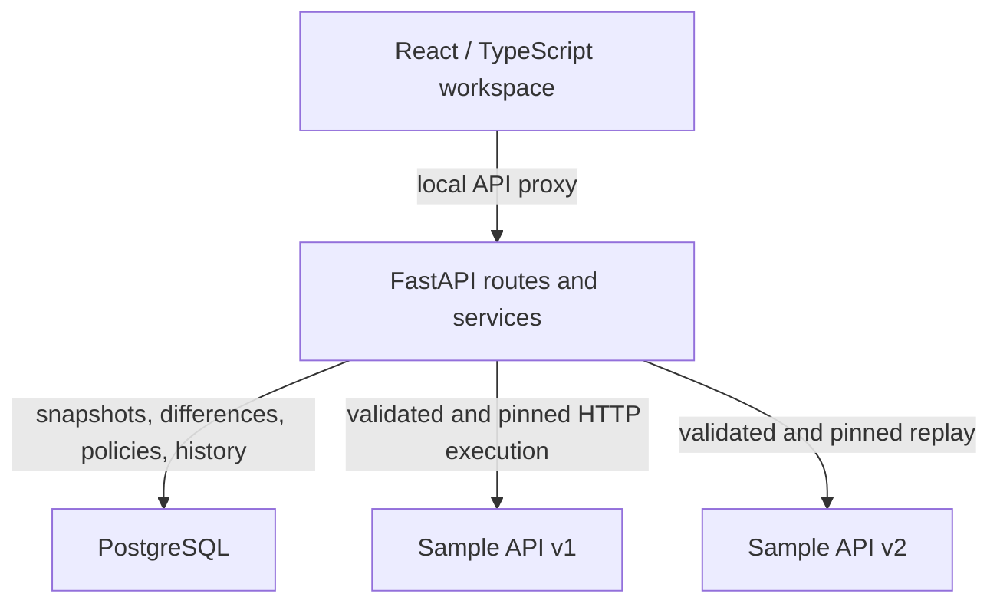

# API TimeMachine

**Record an API. Replay a version. Explain the regression.**

API TimeMachine is a local developer tool for investigating API behavior changes. It saves sanitized HTTP request/response evidence, replays selected requests against an approved target, compares the saved responses, and explains compatibility risks with links to the underlying evidence. Explicit endpoint contracts distinguish confirmed violations from potential risks and unknowns.

**Release 1.0.0 · Phase 5 integration and release preparation.** The native PostgreSQL workflow, 209 backend tests, 27 UI tests, and TypeScript/production build passed. The interface has since been redesigned and a real desktop-browser workflow reviewed. Docker startup, automated browser-suite execution and mobile visual checks remain open. See [the interface revision](docs/INTERFACE.md) and [the original verification report](docs/VERIFICATION.md) for exact scope.

## What it does

- Manage projects and execute GET, POST, PUT, PATCH and DELETE requests with headers, repeated query parameters and JSON bodies.
- Persist sanitized snapshots, mark baselines, and search/filter paginated recording summaries.
- Replay single requests or bounded sequential batches with temporary credentials and write confirmation; preserve originals and session history.
- Detect nested JSON additions, removals, type/value changes, HTTP status/header changes and text differences; apply explicit ignore and unordered-array rules.
- Choose **Compare & analyze** to produce a saved compatibility assessment from a completed replay without sending another target request.
- Review classifications, severity, evidence and recommended actions; edit endpoint policies and retain previous results.
- Reopen historical runs from **Reports** and download bounded JSON or self-contained HTML reports.

## Architecture



The shared HTTP executor validates the actual destination address, enforces deadlines and capture limits, and redacts data before persistence. Replay stores separate results. Comparison and compatibility services read that saved evidence; versioned configuration hashes let repeated calculations reuse immutable results. Thin routes, Pydantic schemas, SQLAlchemy models and Alembic migrations keep these responsibilities separate.

| Layer | Actual stack |
| --- | --- |
| Backend | Python 3.12, FastAPI, HTTPX, Pydantic, SQLAlchemy, Alembic |
| Database | PostgreSQL with JSONB; Compose specifies PostgreSQL 17; native verification used 16.2 |
| Frontend | React 19, TypeScript, Vite, React Router, Tailwind CSS, Lucide |
| Verification | pytest, Vitest, Testing Library, Playwright, Ruff |
| Local infrastructure | Docker Compose, two deterministic FastAPI sample services |

Exact versions are pinned in Python requirements and the frontend package lock.

## Run in VS Code

Install Docker Desktop with Compose v2 and Linux containers. Extract this archive and open its **api-timemachine** folder in VS Code. From that folder:

```sh
docker compose up --build
```

The sample setup needs no `.env`. For custom host ports, copy `.env.example` to `.env` before starting (`Copy-Item .env.example .env` in PowerShell or `cp .env.example .env` in bash).

| Service | Local address |
| --- | --- |
| Application | http://localhost:5175 |
| Backend OpenAPI | http://localhost:8002/docs |
| Health | http://localhost:8002/api/health |
| Sample v1 docs | http://localhost:8003/docs |
| Sample v2 docs | http://localhost:8004/docs |
| PostgreSQL | `localhost:5434`, database/user `timemachine` |

All published ports bind to `127.0.0.1`. The backend waits for database/sample health, applies migrations, then starts. The frontend waits for backend health. Captures and history live in the named `postgres_data` volume. `docker compose down` followed by `docker compose up --build` retains it; do not remove the volume to preserve data.

**Backend targets inside Docker:** `http://sample-api:8001` and `http://sample-api-v2:8001`. These differ from browser-facing sample ports. Preserve these established service names when upgrading. Phase 5 has no new database migration; the head remains `0004_compatibility`.

For a Python/Node development setup, configuration, migrations and troubleshooting, use [SETUP.md](docs/SETUP.md). Python 3.12 and Node 22.12+ are supported by the documented setup; verification used Python 3.12 and Node 24.

## Three-to-five-minute demo

1. Create **Sample API Regression Testing** targeting v1, then send `GET /users/1` and mark the saved response as a baseline.
2. Select that recording in **Replay**, target v2 and run it. Show the original and replayed response panels.
3. Choose **Compare & analyze**. Inspect the detected changes and explain why potential findings need a declared contract to become confirmed violations.
4. Apply the small policy in [DEMO.md](docs/DEMO.md), then choose **Compare & analyze** again. The fixture produces two explicit violations: missing `/data/name` and a changed type at `/data/id`.
5. Follow the finding evidence, download JSON/HTML, and reopen the historical run from **Reports**.

To prepare the same data through real APIs, with the app already running:

```sh
python scripts/release_demo.py
```

This creates a project, one GET baseline, one replay and two historical assessments. It checks actual results and prints links. It never deletes data or sends target-side writes. Add `--report-dir demo-output` to save both real report downloads locally. [Exact demo steps and narration](docs/DEMO.md).

## Test

Backend, from `backend` with the project's Python environment active:

```sh
python -m pip install -r requirements-dev.txt
python -m pytest -q
```

Default tests use temporary SQLite databases and mocked outbound HTTP. For PostgreSQL service tests, set `TEST_DATABASE_URL`; tests create isolated temporary schemas. For migration round trips, use `TEST_MIGRATION_DATABASE_URL` pointing to a separate empty disposable database. The migration test upgrades and downgrades it and refuses an existing table set. Never use the application database for that variable.

Frontend:

```sh
cd frontend
npm ci
npm run build
npm test
npx playwright install chromium
npm run test:e2e
```

The six Playwright tests require the full running local stack and create development data. Discovery alone is not an executed browser pass. See [verification](docs/VERIFICATION.md) for native target variables, actual results and the two remaining environment checks.

Python correctness lint, from the project root with the development environment active:

```sh
python -m ruff check backend/app backend/tests scripts sample-api
```

## Security and operating limits

This is a **trusted local, single-user application**, with no authentication and one backend process. Do not expose its ports publicly. Outbound execution requires exact approved origins, checks every DNS answer, pins a validated IP while preserving Host/TLS SNI, disables redirects/proxies, and enforces request/response/time/concurrency limits. Capture and replay share a default 120-attempt rolling one-minute admission budget. Limits and startup recovery are process-local.

Known credentials and temporary replay values are redacted before storage; key/pattern redaction cannot recognize every secret or PII value. Do not place secrets in paths or labels. Only JSON/text responses are captured; oversized or unsupported bodies are omitted explicitly. UI write confirmation does not make writes reversible. A target may process a call even if subsequent persistence fails; no automatic retry is performed.

Reports describe observed behavior under configured rules and policies, not universal consumer compatibility. Masked, missing, ignored and incomplete evidence remains unassessed. JSON exports are capped at 2 MB, HTML at 4 MB, and the report states any findings omitted by its 500-finding limit. [Security design](docs/SECURITY.md).

## Release documentation

- [Interface redesign](docs/INTERFACE.md): design changes and the subsequent desktop-browser workflow review.

- [Completion report](docs/PHASE5.md): verification matrix, changed files, deployment status, limitations, GitHub readiness, resume bullets and interview preparation.
- [Audit and resolutions](docs/RELEASE_AUDIT.md), [setup](docs/SETUP.md), [demo](docs/DEMO.md), and [executed verification](docs/VERIFICATION.md).
- Detailed subsystem references: [replay](docs/PHASE2.md), [comparison](docs/PHASE3.md), [compatibility](docs/PHASE4.md).

## Screenshots

No screenshots are included in the source package. A subsequent desktop browser walkthrough reviewed the redesigned interface with real API data; further browser review was interrupted by an environment URL-policy block. Mobile visual verification remains open. See [the interface revision](docs/INTERFACE.md). To capture genuine application screenshots locally while running the Playwright journeys, set `SCREENSHOT_DIR` to an existing output directory. The included tests support desktop and narrow-layout checks. Add reviewed captures to the repository after running them.

## Future work

Named CI regression suites, scheduled checks and OpenAPI contract import are possible extensions; they are not implemented. A hosted execution service would additionally need authentication, authorization, coordinated job ownership and enforced network isolation. No hosted deployment is included.

## License

No license has been selected by the repository owner; this release does not add one.
